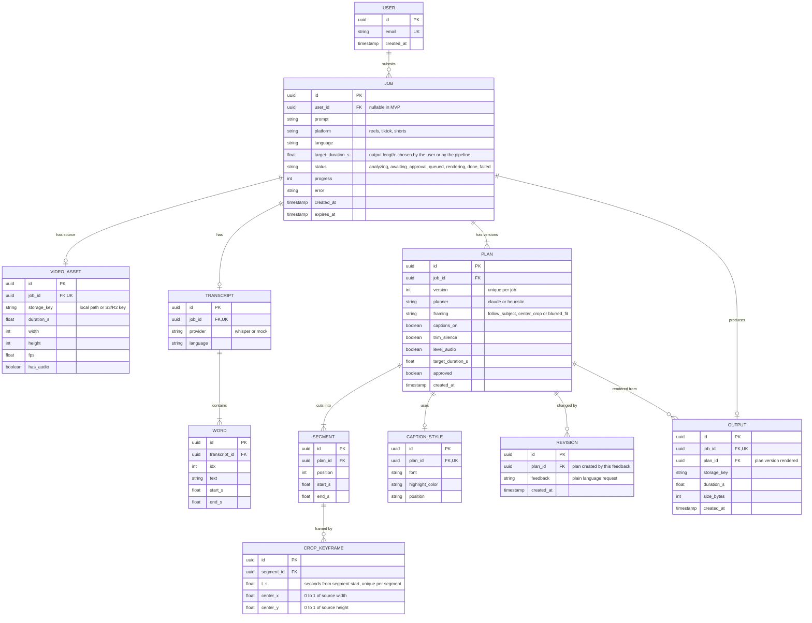

# Reelsmith (MVP)

Upload a video, describe the edit in plain language, approve the plan, and get back a captioned vertical clip ready for Reels, TikTok or Shorts.

> Status: spec-first MVP, written in Node + TypeScript. The code is not written yet, so the instructions below describe the target.

## How it works

1. **Upload** a video and a prompt (mobile friendly web page).
2. **Probe + transcribe**: ffprobe reads the video; Whisper returns word timestamps. When framing is `follow_subject`, a detector also finds the main subject in sampled frames (see [Subject tracking](#subject-tracking)).
3. **Plan**: Claude reads your prompt and the transcript and returns a JSON edit plan (segments, captions, framing, audio). Without an API key a simple heuristic planner is used instead.
4. **Approve**: you see the plan, tweak toggles, or ask for changes in plain language ("make it 15 seconds").
5. **Render**: FFmpeg cuts the segments, trims silences, reframes to the platform size, burns in word-highlight captions and levels the audio.
6. **Download or share** the MP4.

## Run it

Requirements: Node 22+, FFmpeg and ffprobe on your PATH.

```bash
npm install
cp .env.example .env     # add ANTHROPIC_API_KEY and OPENAI_API_KEY
npm run build            # compiles src/*.ts to dist/
npm start                # http://localhost:3000
npm run dev              # alternative: tsx watch, restarts on change
```

No keys yet? Run fully offline with fake speech and the simple planner:

```bash
TRANSCRIBE_PROVIDER=mock PLANNER_PROVIDER=heuristic npm start
npm run smoke            # in a second terminal: end-to-end test
```

Environment variables (see `.env.example`):

| Variable | Purpose |
|---|---|
| `ANTHROPIC_API_KEY` | Claude planner |
| `OPENAI_API_KEY` | Whisper transcription |
| `TRANSCRIBE_PROVIDER` | `mock` for fake speech, otherwise Whisper |
| `PLANNER_PROVIDER` | `heuristic` for the simple planner, otherwise Claude |

## API

| Method | Path | Purpose |
|---|---|---|
| POST | `/api/jobs` | multipart: `video`, `prompt`, `platform`, optional `language`, optional `targetDurationS` (seconds) |
| GET | `/api/jobs/:id` | status, progress, plan, estimate, output |
| POST | `/api/jobs/:id/revise` | `{ "feedback": "..." }` updates the plan |
| POST | `/api/jobs/:id/approve` | optional overrides, starts the render |
| GET | `/api/jobs/:id/video` | the MP4 (`?download=1` to save) |
| DELETE | `/api/jobs/:id` | remove the job and its files |

Statuses: `analyzing`, `awaiting_approval`, `queued`, `rendering`, `done`, `failed`.

## Layout

Requests flow through layers, and each layer only talks to the one below it: **route → middleware → controller → service → queries → database**.

```
package.json            scripts: dev, build, start, typecheck, smoke, db:*
tsconfig.json           compiler options (output in dist/)
db/migrations/          schema migrations (node-pg-migrate), seed.sql, tests/smoke.sql
scripts/db.mjs          helper behind the npm run db:* scripts
public/index.html       mobile friendly UI

src/server.ts           starts the server and shuts it down cleanly
src/app.ts              builds the Express app (middleware, routes, error handling)

src/config/             the app's settings and setup:
                        index.ts (settings from environment variables),
                        database.ts (Postgres connection pool),
                        presets.ts (platform sizes and length limits)

src/helpers/            small reusable functions used across the layers:
                        env.ts (read env variables), errors.ts (HttpError),
                        duration.ts (output length rules), checkPlan.ts (plan safety check),
                        storage.ts (files on disk; swap for S3/R2 later),
                        jobResponse.ts (database rows to API JSON)

src/routes/             URL to controller wiring (jobs.routes.ts, index.ts)
src/middleware/         asyncHandler, validate (zod), upload (multer), errorHandler
src/controllers/        HTTP only: read the request, call a service, send the response
src/services/           business rules and orchestration (jobs.service.ts)
src/queries/            SQL only (jobs.queries.ts)
src/types/              TypeScript types for database rows and data we save (job.types.ts)
src/schemas/            zod schemas for requests and the edit plan

Pipeline services in src/services/: pipeline, probe, transcribe, planner (+ planner.heuristic).
Still to add: track (subject tracking), ass (captions), render (FFmpeg graph and progress)
```

Adding an endpoint: add a zod schema in `schemas/`, a query in `queries/`, a function in the service, a controller function, and one line in the routes file.

## Data model

The MVP keeps this in memory and on local disk. The diagram is the normalized target schema for PostgreSQL once jobs move out of process. `USER` only appears once authentication is added.



Notes:
- `PLAN` is versioned: each `/revise` call creates a new plan row plus a `REVISION` row holding the feedback, and the approved version is the one rendered. `(job_id, version)` is unique.
- `WORD` rows drive both the planner prompt and the highlighted captions in `src/ass.ts`. `(transcript_id, idx)` is unique.
- `SEGMENT` order comes from `position`, unique per plan.
- `CROP_KEYFRAME` rows hold the smoothed crop path for a segment and only exist when `framing` is `follow_subject`.
- `expires_at` backs the cleanup task that deletes old jobs and files; deletes cascade from `JOB`.

## What happens after an upload

The pipeline (`src/services/pipeline.service.ts`) runs these steps in the background. Each is one small function.

| Step | What it does | Progress |
|---|---|---|
| probe | ffprobe reads length, size, fps and audio; saved in `video_assets` | 30 |
| duration | decides the output length (see below) | 40 |
| transcribe | turns speech into timed words; saved in `transcripts` and `words` | 60 |
| plan | makes the edit plan, checks it, saves `plans`, `segments` and `caption_styles`; status becomes `awaiting_approval` | 100 |

Any failure sets the status to `failed` with a plain-language reason in `error`.

**Providers** (set in `.env`):

- `TRANSCRIBE_PROVIDER=mock` makes up a repeatable transcript (sentences with pauses). Videos with no audio get no words. `whisper` is not built yet.
- `PLANNER_PROVIDER=heuristic` uses simple rules: group words into phrases at pauses longer than 0.6 s, keep phrases from the start until the target length is used up, and cut the pauses between them. With no speech it keeps the start of the video and turns captions off. It ignores the prompt. `claude` is not built yet.

Every plan goes through `src/helpers/checkPlan.ts` before it is saved. It rejects empty plans, segments that end before they start or overlap, segments past the end of the video, and plans longer than the platform allows.

## Output length

The output clip can never be longer than the platform allows or longer than the source video. Limits and preset lengths per platform live in `src/config/presets.ts`.

- **User gives a length** (`targetDurationS` on upload): it must be within the platform limit (otherwise `400`). If the video is shorter, the length is cut down to the video's length.
- **User gives no length**: the pipeline picks the largest preset choice that is not above the platform default (30 s) and fits the video. A 60 s video on Reels gets 30 s. A 3 s clip gets 3 s.
- **Choices**: once the video is probed, `GET /api/jobs/:id` returns `video` (length, size, fps, audio), `targetDurationS` and `durationChoicesS` (the preset lengths that fit this video, for example `[15, 30, 60]`), so the UI can show them.

The rules are in `src/helpers/duration.ts`.

## Subject tracking

Design for replacing the plain center crop with a crop that follows the main subject. It stays inside the Node + TypeScript stack, with no Python sidecar.

**Pipeline** (`src/track.ts`, run after the plan is approved so only kept segments are analysed):

1. **Sample**: FFmpeg extracts frames at 4 fps from each segment, scaled to 360p, so detection cost does not depend on the source resolution.
2. **Detect**: a small face/person detector runs through `onnxruntime-node` on each frame and returns boxes with confidence scores.
3. **Pick the subject**: choose the largest confident face, and stick with it across frames (match by box overlap) so the crop does not jump between people. If the transcript marks different speakers later, this is where speaker-aware switching would plug in.
4. **Smooth**: apply an exponential moving average, a dead zone so small head movements do not move the frame, and a maximum pan speed. Smoothing resets at segment boundaries, where a hard cut is expected.
5. **Simplify**: reduce the path to a few keyframes per segment (Ramer-Douglas-Peucker) so the FFmpeg expression stays short. The keyframes are stored as `CROP_KEYFRAME` rows.
6. **Render**: `src/render.ts` builds a `crop` filter whose `x` and `y` interpolate linearly between keyframes, clamped to the frame, then scales to the platform size.

**Fallbacks**:

- No subject found in a segment: use `center_crop` for that segment.
- Subject wider than the target crop (a group shot): use `blurred_fit` for that segment.
- Detector or model fails: log the error and render with `center_crop`. Tracking never fails the job.

**Plan and UI**: `follow_subject` becomes the default `framing` value. The approval screen keeps a toggle to switch back to `center_crop` or `blurred_fit`. The planner can also pick it from a prompt such as "keep me in frame".

**Config**: `TRACK_PROVIDER=off|onnx` (use `off` in the offline smoke test), `TRACK_FPS` (default 4) and the model path.

**Testing**: the smoke test uses a short clip with a face moving left to right and asserts the crop keyframes move in the same direction. Smoothing and simplification are pure functions with unit tests.

**Open questions**: which detector model and licence to ship, and whether to use multiple subjects when two people are speaking.

## Before real users

This MVP keeps jobs on local disk and runs renders in-process. For production:

- Replace the in-process queue with BullMQ and Redis, and run render workers separately from the API.
- Store uploads and outputs in S3 or R2 (signed URL uploads) instead of local disk.
- Add authentication, per-user quotas and rate limiting, and billing if you charge.
- Put the app behind HTTPS and add error tracking (for example Sentry).
- Check each platform's current length limits and update `src/presets.ts`.
- Only add music from royalty-free sources.

## Known limits

- Reframing follows one subject at a time (see [Subject tracking](#subject-tracking)). It falls back to a center crop or blurred-background fit when no subject is found, and it does not switch between speakers yet.
- Silence trimming only runs when speech was detected.
- Instagram does not allow arbitrary apps to publish for personal accounts, so the app offers download and the phone's share sheet.
