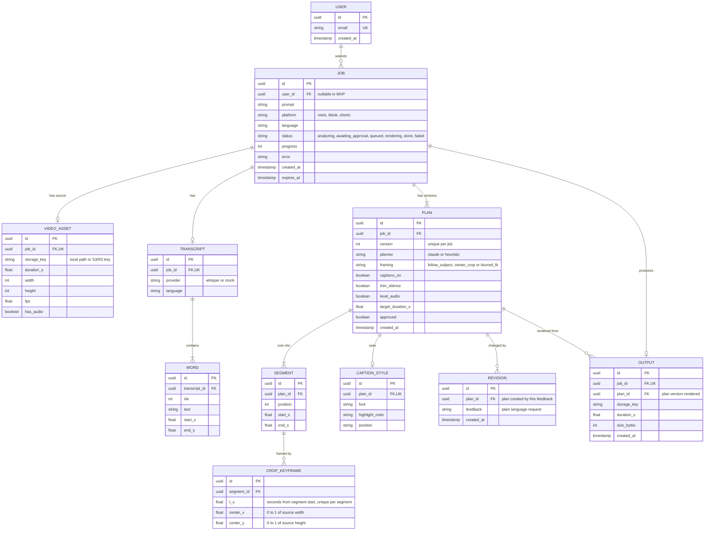

# Reelsmith (MVP)

Upload a video, describe the edit in plain language, approve the plan, and get back a captioned vertical clip ready for Reels, TikTok or Shorts.

> Status: spec-first MVP, written in Node + TypeScript. The code is not written yet, so the instructions below describe the target.

## How it works

1. **Upload** a video and a prompt (mobile friendly web page).
2. **Probe + transcribe**: ffprobe reads the video; Whisper returns word timestamps. When framing is `follow_subject`, a detector also finds the main subject in sampled frames (see [Subject tracking](#subject-tracking)).
3. **Plan**: Claude reads your prompt and the transcript and returns a JSON edit plan (segments, captions, framing, audio). Without an API key a simple heuristic planner is used instead.
4. **Approve**: you see the plan, tweak toggles, or ask for changes in plain language ("make it 15 seconds").
5. **Render**: FFmpeg cuts the segments, trims silences, reframes to the platform size, burns in word-highlight captions and levels the audio.
6. **Download or share** the MP4.

## Run it

Requirements: Node 22+, FFmpeg and ffprobe on your PATH.

```bash
npm install
cp .env.example .env     # add ANTHROPIC_API_KEY and OPENAI_API_KEY
npm run build            # compiles src/*.ts to dist/
npm start                # http://localhost:3000
npm run dev              # alternative: tsx watch, restarts on change
```

No keys yet? Run fully offline with fake speech and the simple planner:

```bash
TRANSCRIBE_PROVIDER=mock PLANNER_PROVIDER=heuristic npm start
npm run smoke            # in a second terminal: end-to-end test
```

Environment variables (see `.env.example`):

| Variable | Purpose |
|---|---|
| `ANTHROPIC_API_KEY` | Claude planner |
| `OPENAI_API_KEY` | Whisper transcription |
| `TRANSCRIBE_PROVIDER` | `mock` for fake speech, otherwise Whisper |
| `PLANNER_PROVIDER` | `heuristic` for the simple planner, otherwise Claude |

## API

| Method | Path | Purpose |
|---|---|---|
| POST | `/api/jobs` | multipart: `video`, `prompt`, `platform`, optional `language` |
| GET | `/api/jobs/:id` | status, progress, plan, estimate, output |
| POST | `/api/jobs/:id/revise` | `{ "feedback": "..." }` updates the plan |
| POST | `/api/jobs/:id/approve` | optional overrides, starts the render |
| GET | `/api/jobs/:id/video` | the MP4 (`?download=1` to save) |
| DELETE | `/api/jobs/:id` | remove the job and its files |

Statuses: `analyzing`, `awaiting_approval`, `queued`, `rendering`, `done`, `failed`.

## Layout

```
package.json      scripts: build, start, dev, smoke
tsconfig.json     compiler options (output in dist/)
src/server.ts     Express API and static hosting
src/jobs.ts       job store, pipeline, render queue, cleanup
src/probe.ts      ffprobe and silence detection
src/transcribe.ts Whisper API (plus mock provider)
src/planner.ts    Claude planner and heuristic fallback
src/schema.ts     plan validation (zod) and safety clamps
src/ass.ts        caption file with word highlighting
src/track.ts      subject detection, smoothing and crop keyframes
src/render.ts     FFmpeg filter graph and progress
src/presets.ts    platform sizes and length limits
public/index.html mobile friendly UI
```

## Data model

The MVP keeps this in memory and on local disk. The diagram is the normalized target schema for PostgreSQL once jobs move out of process. `USER` only appears once authentication is added.



Notes:
- `PLAN` is versioned: each `/revise` call creates a new plan row plus a `REVISION` row holding the feedback, and the approved version is the one rendered. `(job_id, version)` is unique.
- `WORD` rows drive both the planner prompt and the highlighted captions in `src/ass.ts`. `(transcript_id, idx)` is unique.
- `SEGMENT` order comes from `position`, unique per plan.
- `CROP_KEYFRAME` rows hold the smoothed crop path for a segment and only exist when `framing` is `follow_subject`.
- `expires_at` backs the cleanup task that deletes old jobs and files; deletes cascade from `JOB`.

## Subject tracking

Design for replacing the plain center crop with a crop that follows the main subject. It stays inside the Node + TypeScript stack, with no Python sidecar.

**Pipeline** (`src/track.ts`, run after the plan is approved so only kept segments are analysed):

1. **Sample**: FFmpeg extracts frames at 4 fps from each segment, scaled to 360p, so detection cost does not depend on the source resolution.
2. **Detect**: a small face/person detector runs through `onnxruntime-node` on each frame and returns boxes with confidence scores.
3. **Pick the subject**: choose the largest confident face, and stick with it across frames (match by box overlap) so the crop does not jump between people. If the transcript marks different speakers later, this is where speaker-aware switching would plug in.
4. **Smooth**: apply an exponential moving average, a dead zone so small head movements do not move the frame, and a maximum pan speed. Smoothing resets at segment boundaries, where a hard cut is expected.
5. **Simplify**: reduce the path to a few keyframes per segment (Ramer-Douglas-Peucker) so the FFmpeg expression stays short. The keyframes are stored as `CROP_KEYFRAME` rows.
6. **Render**: `src/render.ts` builds a `crop` filter whose `x` and `y` interpolate linearly between keyframes, clamped to the frame, then scales to the platform size.

**Fallbacks**:

- No subject found in a segment: use `center_crop` for that segment.
- Subject wider than the target crop (a group shot): use `blurred_fit` for that segment.
- Detector or model fails: log the error and render with `center_crop`. Tracking never fails the job.

**Plan and UI**: `follow_subject` becomes the default `framing` value. The approval screen keeps a toggle to switch back to `center_crop` or `blurred_fit`. The planner can also pick it from a prompt such as "keep me in frame".

**Config**: `TRACK_PROVIDER=off|onnx` (use `off` in the offline smoke test), `TRACK_FPS` (default 4) and the model path.

**Testing**: the smoke test uses a short clip with a face moving left to right and asserts the crop keyframes move in the same direction. Smoothing and simplification are pure functions with unit tests.

**Open questions**: which detector model and licence to ship, and whether to use multiple subjects when two people are speaking.

## Before real users

This MVP keeps jobs on local disk and runs renders in-process. For production:

- Replace the in-process queue with BullMQ and Redis, and run render workers separately from the API.
- Store uploads and outputs in S3 or R2 (signed URL uploads) instead of local disk.
- Add authentication, per-user quotas and rate limiting, and billing if you charge.
- Put the app behind HTTPS and add error tracking (for example Sentry).
- Check each platform's current length limits and update `src/presets.ts`.
- Only add music from royalty-free sources.

## Known limits

- Reframing follows one subject at a time (see [Subject tracking](#subject-tracking)). It falls back to a center crop or blurred-background fit when no subject is found, and it does not switch between speakers yet.
- Silence trimming only runs when speech was detected.
- Instagram does not allow arbitrary apps to publish for personal accounts, so the app offers download and the phone's share sheet.
